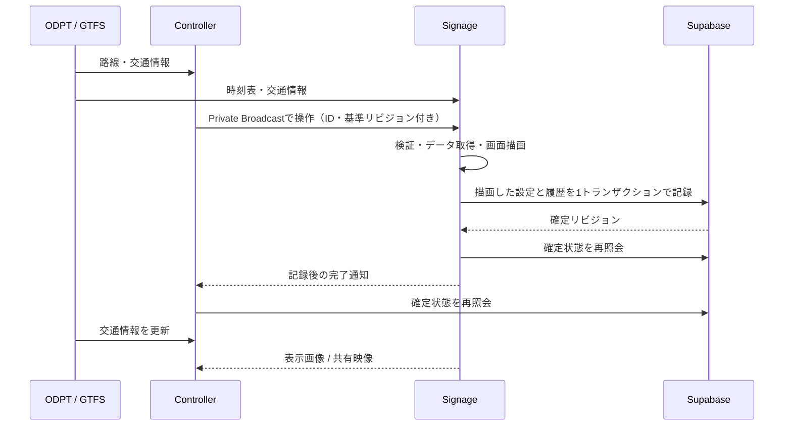

# D-TIS — GitHub Pages版

SignageとControllerを静的なウェブアプリとして公開します。実行用のNode.jsサーバーやExpressは不要です。交通情報は各ブラウザーがODPT・GTFSから取得し、操作の中継と確定済み設定の記録にSupabaseを使用します。

## 最初に行うこと

1. Supabaseでプロジェクトを作成します。
2. **SQL Editor**で[`supabase/setup.sql`](supabase/setup.sql)全体を実行します。再実行しても既存の端末と履歴を残します。
3. **Authentication → Users → Add user**でメールアドレスとパスワードの運用ユーザーを作ります。確認済みユーザーとして登録します。アプリに新規登録機能はありません。一般公開のユーザー登録が不要なら、Authのユーザー登録を無効にします。
4. **Realtime → Settings**で **Allow public access** をオフにします。このアプリは所有者を確認するPrivate Broadcastを使います。テーブルのRealtime publicationやStorage、Edge Functionsの設定は不要です。
5. フォルダーをGitHubへ追加し、**Settings → Pages → Source → GitHub Actions**を選びます。`main`へpushすると、同梱のワークフローがテスト・ビルド・公開を実行します。詳細は[`docs/github-pages.md`](docs/github-pages.md)を参照してください。
6. 公開された`/signage/`と`/controller/`を開き、**Supabase Project URL**と**Publishable key**を設定します。両方の画面に手順3の同じ運用アカウントでログインします。
7. 両画面の右下の**接続設定**に、ODPT APIトークン、またはGTFS ScheduleのZIP URLを設定します。両方で同じ配信元を指定してください。Signageを表示したまま、Controllerで路線・施設名・案内文を設定し、**Signageに反映して記録**を選びます。

SupabaseのProject URLとpublishable keyは、GitHub Repository variablesの`VITE_SUPABASE_URL`と`VITE_SUPABASE_PUBLISHABLE_KEY`に設定して初期値にすることもできます。ブラウザーへ渡すのは公開用のキーだけです。`service_role`、`sb_secret_…`、データベースパスワードを使わないでください。

## 操作と同期の流れ



- Controllerは操作送信時に確定設定を書き換えません。Signageの描画後にのみ、設定と操作履歴を同時に保存します。ブラウザーが前面にあり描画が進むことを確認します。物理モニターの電源状態を検出する機能ではありません。
- リビジョン比較により、複数Controllerからの古い設定による上書きを拒否します。未保存の編集内容は定期照会で消しません。
- 操作は30秒で期限切れになり、切断中の操作を後から自動実行しません。通信の配送通知と描画完了の通知は区別します。
- 記録の成否が通信切断で分からなくなったときは、同じ操作IDの記録を照会して照合します。Supabaseに確認できない間は成功と表示しません。
- **両画面の交通情報を更新**は、Signageの交通情報を更新・記録した後、ControllerもSupabaseと配信元を照会します。ブラウザー全体のリロードは不要です。
- Signageは最後に取得できた時刻表をIndexedDBへ保存し、通信障害時に継続表示します。未取得の路線をオフラインで新しく表示することはできません。GitHub Pages自体の初回ロードには通信が必要です。

## ライブ画面

Controllerの**Signageのライブ画面**には、Signage側で描画したDOMの画像を約2秒間隔で送信します。Controller側で時刻表を再現するプレビューではありません。画像には取得時刻と実際に表示している出力IDを表示し、切断後は最終画像であることを表示します。閲覧者がいる間だけ画像を送信します。

より滑らかな実画面を見るには、Signage左下の**映像で画面を共有**を押し、ブラウザーの選択画面で**Signageタブ**を選びます。WebRTCで共有映像をControllerへ送ります。ブラウザーの仕様により、この画面選択は端末側の操作が必要で、自動許可はできません。音声・マウス・キーボードのリモート操作は扱いません。

標準の画像プレビューはSupabaseだけで利用できます。DOMの画像化ではフォントやアニメーションを完全には再現できない場合があります。WebRTCはネットワーク構成により接続できないことがあり、その場合は画像プレビューを継続します。必要な環境では任意でTURNサーバーを`VITE_WEBRTC_ICE_SERVERS`に設定できます。TURNが常時必要な運用では、その認証情報を固定の秘密情報として公開ビルドへ埋め込まないでください。

## ODPT・GTFS

- ODPT JSONは従来の鉄道・バス情報の正規化処理をブラウザー用に移し、路線・駅・方面・時刻・種別・行先・取得できる両数を表示します。
- GTFSは**GTFS Schedule ZIP**に対応します。運行日、例外日、24時以降の時刻、固定間隔の時刻指定を扱います。GTFS Realtimeや不定時刻の頻度運行の完全対応ではありません。
- 配信元はブラウザーからのHTTPSアクセスとCORSを許可している必要があります。GitHub Pagesではサーバープロキシを動かせません。外部配信元でCORSを利用できない場合、許可されたGTFSを同じPages配下へ置くなど、配信条件に合う方法を用意してください。
- ODPTトークンは各ブラウザーのlocalStorageに保存します。公開用GitHub Actionsはトークンをビルドへ埋め込みません。静的アプリで利用するAPIトークンは、その端末の利用者から完全には隠せません。
- 交通情報の取得失敗時は取得済みキャッシュを使用し、更新に失敗したことを表示します。両者のODPT取得時刻は別々ですが、Controllerのライブ画面で実際のSignage表示を確認できます。

## 端末・設備の扱い

SignageはブラウザーごとのIDで登録され、同じSupabaseアカウントのControllerに表示されます。LAN内のIPアドレスやPINは使いません。別のブラウザープロファイル・別端末で開くと別のSignageになります。ブラウザーデータを消すと端末IDも失われるため、運用端末のデータを保持してください。

1つのブラウザーでは同じSignageを複数タブで同時に動かさないでください。対応ブラウザーではWeb Locksで二重起動を防ぎます。Signageタブは前面で表示して運用します。

設備ごとの設定は保持でき、Signage URLの`?output=設備ID`で表示対象を選びます。Controllerの設備タブを切り替えても、物理Signageの表示出力は切り替わりません。ライブ画面は、その端末で実際に開いている出力を表示します。LCD以外の物理LED・ベルの駆動は、機器側の対応が別途必要です。

ブラウザーの静的アプリからOSの再起動・電源オフはできないため、新しいControllerにはOSの電源操作を設けていません。旧`server/`とPi用スクリプトは移行前の参考資料です。新しい画面を旧LAN/PIN方式で動かす互換機能はありません。

## ローカル開発・検証

Node.js 22以降を使用します。

```sh
npm ci
npm test
npm run build
npm run preview
```

プレビューは案内ページ`http://localhost:4173/`、Signage`/signage/`、Controller`/controller/`です。開発時は`npm run dev`で3画面を起動できます。認証・操作の確認にはSupabaseを設定します。静的ビルドにはSupabaseの資格情報は不要です。

```sh
npx playwright install chromium
npm run test:e2e
```

ブラウザーテストはローカルの模擬Supabaseを使用します。実際のSupabaseプロジェクトに接続・変更しません。実プロジェクトでの認証・Realtime・ネットワーク条件の最終確認は、設定後に行ってください。

## 主なファイル

| 場所 | 役割 |
| --- | --- |
| `signage/src/useSignageRuntime.ts` | Signageでの操作検証・描画・記録・復旧 |
| `controller/src/main.tsx` | 設定編集・操作送信・確定状態照会 |
| `shared/cloud.ts` | Supabase Auth・Database・Private Broadcast |
| `shared/cloud-protocol.ts` | 操作と設定の形式・期限検証 |
| `shared/browser-odpt.ts` | ブラウザーからの交通情報取得・キャッシュ |
| `shared/browser-gtfs.ts` | GTFS Schedule ZIP読み込み |
| `shared/live-preview.tsx` | 実表示の画像送信・WebRTC映像共有 |
| `supabase/setup.sql` | テーブル・所有者別RLS・記録RPC |
| `.github/workflows/pages.yml` | GitHub Pagesへのテスト・公開 |

## 公式資料

- [Supabase Private Broadcast](https://supabase.com/docs/guides/realtime/broadcast)
- [Supabase Realtimeのアクセス制御](https://supabase.com/docs/guides/realtime/authorization)
- [Supabaseメール・パスワード認証](https://supabase.com/docs/guides/auth/passwords)
- [GitHub Pagesのカスタムワークフロー](https://docs.github.com/en/pages/getting-started-with-github-pages/using-custom-workflows-with-github-pages)
- [ODPT開発者サイト](https://developer.odpt.org/)
